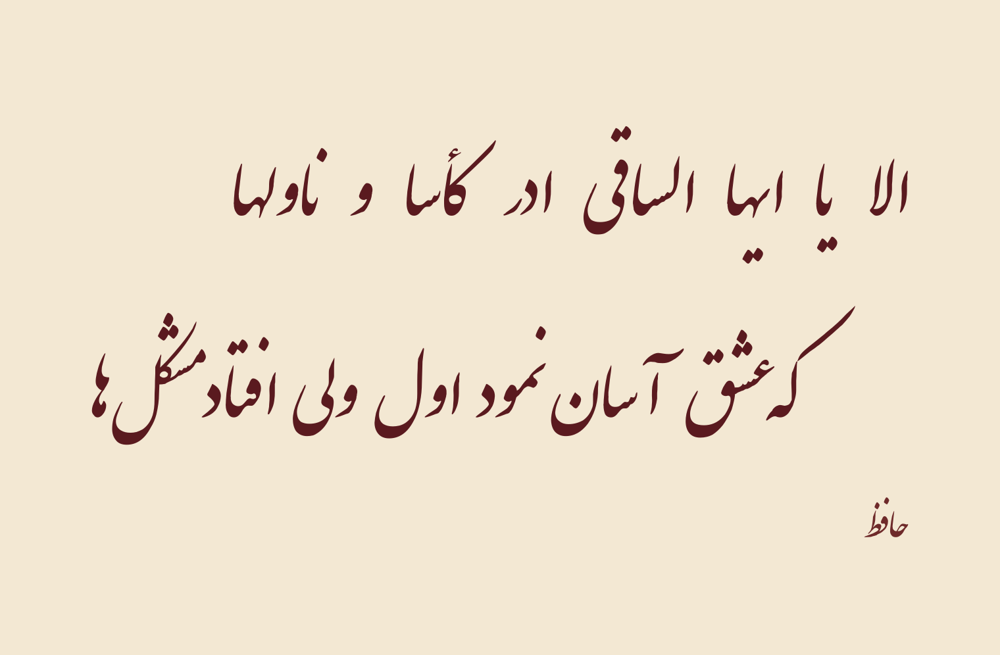
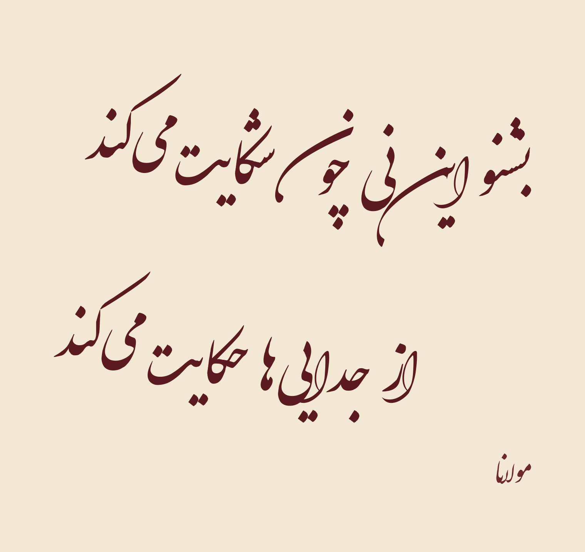
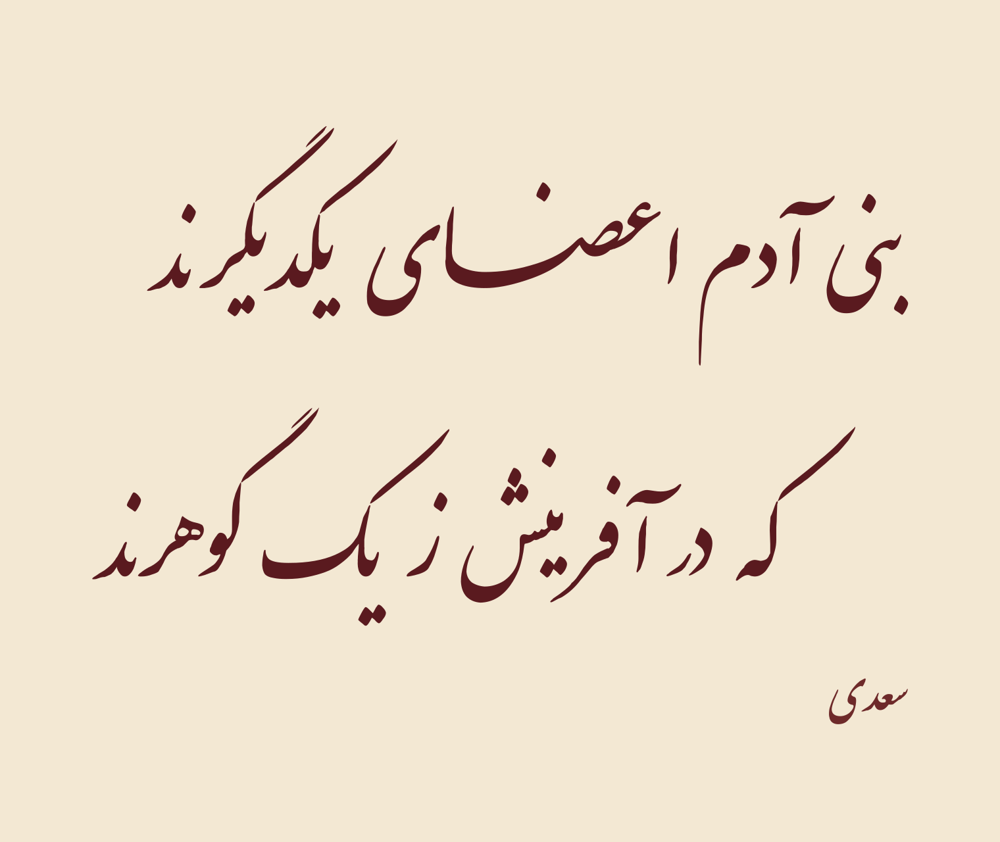
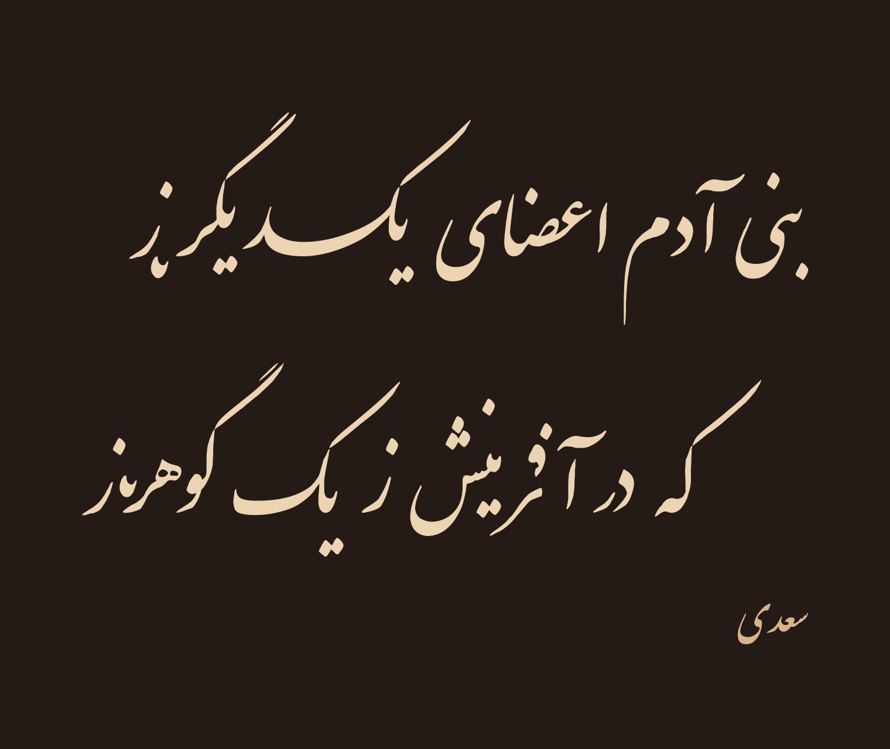
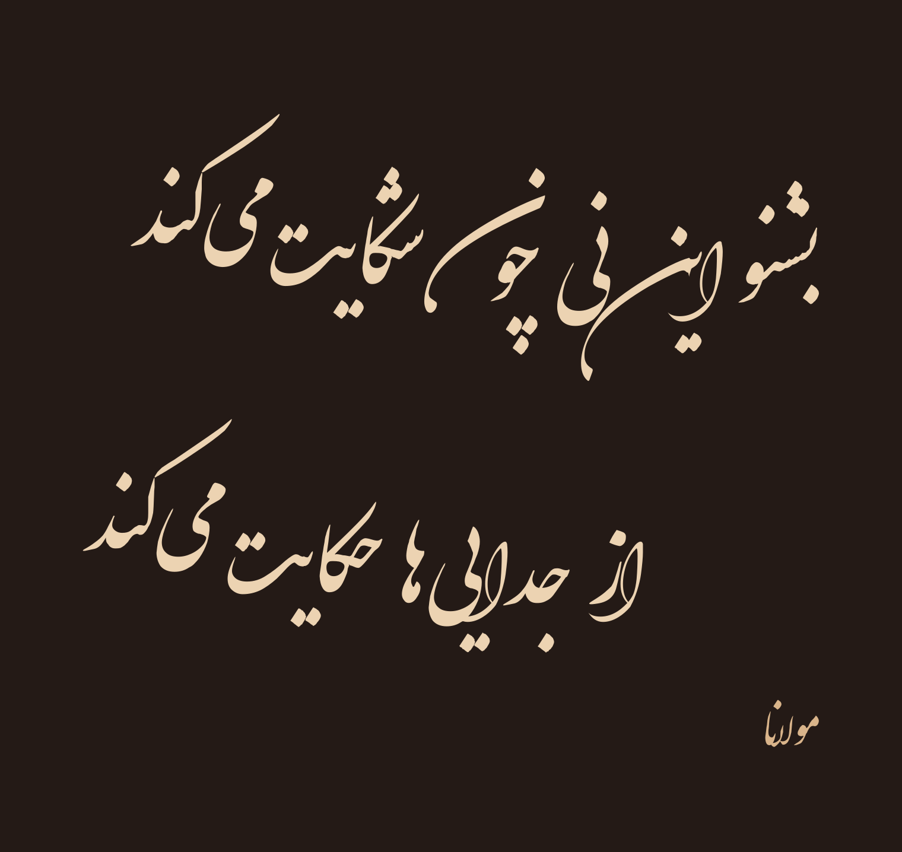
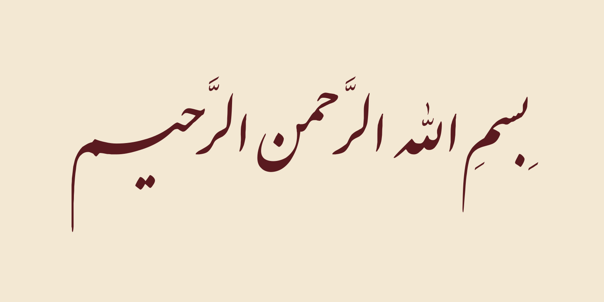
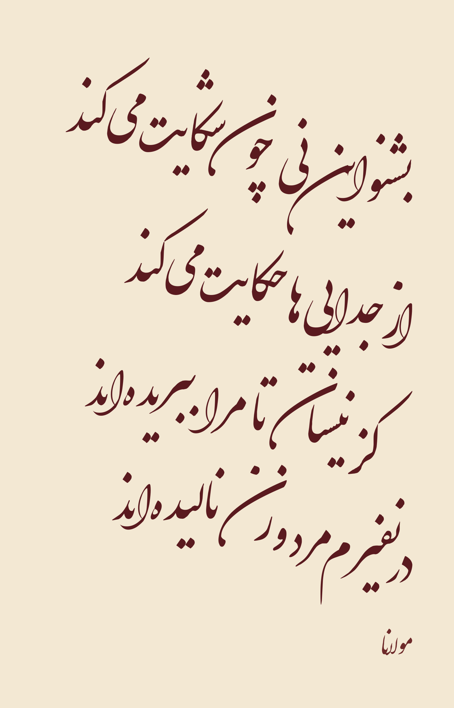
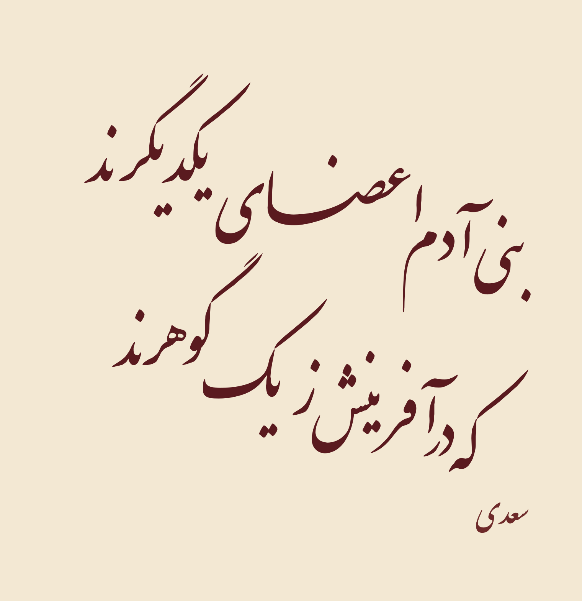
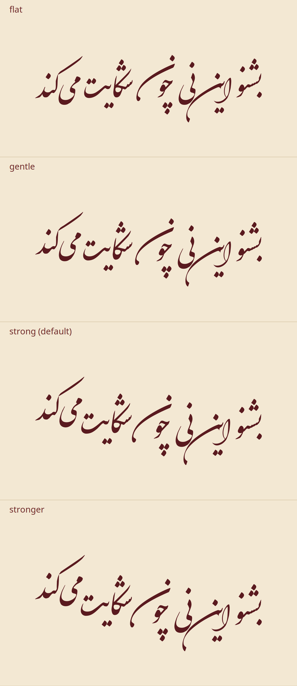

# Persian Calligraphy skill

An agent skill (Claude Code / Claude.ai) and standalone renderer that typesets Persian poetry as
**Nastaliq** or **Shekasteh-Nastaliq** calligraphy and outputs a clean vector SVG manuscript sheet.

<p align="center">
  
  
</p>

The letters are the fonts' own glyph outlines. The renderer adds the typesetting that a plain text
engine leaves out:

- **Ink-based word spacing**: words slide together until their *ink* is a fixed distance apart, so
  gaps look even even though word shapes are not.
- **Keshideh (kashida)** in Nastaliq: one designed long stroke at a classical place (اعضـای, الرحیـم), never on س/ش, on the
  shorter misra', after which both misra' are matched in length to within about 1%.
- **Rising line end** in Shekasteh: the line lifts toward its end, as a Shekasteh hand writes.
- **Fused letter pairs** in Shekasteh (`cswh`), e.g. شک and حک.
- **Collision fixing**: after the page is laid out, one pass checks every dot, madda and hamza against
  all ink on the page and moves only the ones that collide, just far enough to clear it (a letter's
  dots move together). Tashkil go through the same pass, drawn in a slightly finer size and kept
  clear of all ink. Anything it can't clear cleanly is reported, not forced.
- **Mashq mode** (`--mashq`): the flow of a master's practice sheet: lines climbing on a diagonal,
  tight tucked words, interlocking lines, and dots spread into the open space.
- **Bayt layout**: staggered misra', a half-size signature (raqam), and light/dark themes in one SVG.

## Samples

| | |
|---|---|
| **Saadi, Nastaliq** — keshideh on اعضـای<br> | **Saadi, Nastaliq, dark mode**<br> |
| **Rumi, Shekasteh, dark mode**<br> | **Bismillah, light tashkil** — بِسمِ الله الرَّحمن الرَّحیم<br> |

**Mashq mode** (`--mashq`): lines climb on a diagonal, words tuck into each other, lines interlock, and
dots are spaced into the open white, after the way a master writes a practice sheet:

| | |
|---|---|
| **Rumi, Shekasteh, mashq**<br> | **Saadi, Nastaliq, mashq**<br> |

The SVG source of each sample is in [`samples/`](samples/).

**Shekasteh rise presets** (`--rise flat | gentle | medium | strong | stronger`):

<p align="center"></p>

## Usage

```bash
python -m venv .venv && . .venv/bin/activate
pip install -r requirements.txt

# a bayt: pass each misra' as its own argument
python scripts/render.py --style nastaliq \
    "بنی آدم اعضای یکدیگرند" "که در آفرینش ز یک گوهرند" \
    --author "سعدی" -o saadi.svg --png saadi.png

python scripts/render.py --style shekasteh \
    "بشنو این نی چون شکایت می‌کند" "از جدایی‌ها حکایت می‌کند" \
    --author "مولانا" -o rumi.svg --png rumi.png
```

Each run prints what it did:

```
  keshideh: misra' 1, word 'اعضـای' (+63%)
  gaps: 15px / 14px, width diff 0.2%
  moved: dot of ی in یکدیگرند
  moved: dot of ی in آفرینش
```

| Option | Effect |
|---|---|
| `--style nastaliq\|shekasteh` | font and style rules |
| `--author TEXT` | signature in the lower corner, at half size |
| `--rise PRESET` | Shekasteh line-end rise (default `strong`) |
| `--no-cswh` | Shekasteh: no fused letters (easier to read) |
| `--no-keshideh` / `--no-equalize` | Nastaliq: no automatic keshideh / don't match the misra' lengths |
| `--layout auto\|stagger\|center` | `auto`: one line is centred, two or more are staggered |
| `--mashq` | master's-sheet flow: diagonal climb, tucked words, interlocking lines, dots spread into open space |
| `--no-dot-fix` | leave every dot and mark where the font puts it (to compare) |
| `--png FILE` `--dark` | PNG preview (light or dark) |
| `--timeout SECONDS` | hard time limit (default 300) |

### Reproducing the samples

Every image in `samples/` is built by [`scripts/make_samples.py`](scripts/make_samples.py), which
records the exact text and options of each one:

```bash
python scripts/make_samples.py           # rebuild samples/
python scripts/make_samples.py --check   # regression test: fresh renders vs samples/
```

After changing `render.py`, run `--check`. Only the samples you meant to change may differ; for
each one that does, compare before/after crops of the changed region before accepting it.

If you type a tatweel (ـ) yourself, the renderer uses your keshideh and skips the automatic one.

## Using it as a skill

Copy or clone this folder into your skills directory, e.g. `~/.claude/skills/persian-calligraphy/`.
[`SKILL.md`](SKILL.md) holds the rules the agent follows: choosing the text and its edition, font
licensing, honesty about typeset versus hand-written work, the style rules, checks before sending,
and how to write the reply.

## Fonts and licenses

| Font | License | Source |
|---|---|---|
| IranNastaliq 1.5 | SIL OFL 1.1 | [farsi-fonts/fonts-irannastaliq](https://github.com/farsi-fonts/fonts-irannastaliq) |
| Dima Shekasteh Free 2.001 | GNU GPL v2 | [ahangarha/dima](https://github.com/ahangarha/dima) (Dima Group, R. Balvardi) |

Both fonts are bundled unmodified under their own licenses (see [`fonts/README.md`](fonts/README.md)).
The code and docs are [MIT](LICENSE).

## Limitations

The output is **typeset, not hand-written**. No font reproduces a calligrapher's hand. The renderer
only places and moves the fonts' own shapes (whole words, whole dots, whole marks) and never draws
letters itself. Mashq mode imitates a master's spacing, flow and dot placement, but not the long
swept strokes or slanted words of a hand-written sheet.
