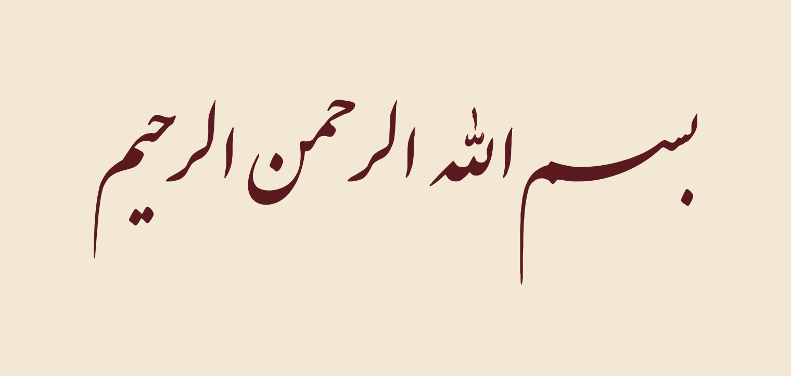

# Persian Calligraphy skill

An agent skill (Claude Code / Claude.ai) and standalone renderer that typesets Persian poetry as
**Nastaliq** or **Shekasteh-Nastaliq** calligraphy and outputs a clean vector SVG manuscript sheet.

<p align="center">
  
  
</p>

The letters are the fonts' own glyph outlines. The renderer adds the typesetting that a plain text
engine leaves out:

- **Ink-based word spacing**: words slide together until their *ink* is a fixed distance apart, so
  gaps look even even though word shapes are not.
- **Keshideh (kashida)** in Nastaliq: one designed long stroke at a classical place, preferring the sin family (اعضـای, کأسـا, بسـم), on the
  shorter misra', after which both misra' are matched in length to within about 1%.
- **Rising line end** in Shekasteh: the line lifts toward its end, as a Shekasteh hand writes.
- **Fused letter pairs** in Shekasteh (`cswh`), e.g. شک and حک.
- **Collision fixing**: dots, maddas and hamzas that land on a neighbouring letter are moved just far
  enough to clear it, and are left in place when no move would help.
- **Bayt layout**: staggered misra', a half-size signature (raqam), and light/dark themes in one SVG.

## Samples

| | |
|---|---|
| **Saadi, Nastaliq** — keshideh on اعضـای<br> | **Saadi, Nastaliq, dark mode**<br> |
| **Rumi, Shekasteh, dark mode**<br> | **Bismillah, single centred line** — keshideh on بسـم<br> |

The SVG source of each sample is in [`samples/`](samples/).

**Shekasteh rise presets** (`--rise flat | gentle | medium | strong | stronger`):

<p align="center"></p>

## Usage

```bash
python -m venv .venv && . .venv/bin/activate
pip install -r requirements.txt

# a bayt: pass each misra' as its own argument
python scripts/render.py --style nastaliq \
    "الا یا ایها الساقی ادر کأسا و ناولها" "که عشق آسان نمود اول ولی افتاد مشکل‌ها" \
    --author "حافظ" -o hafez.svg --png hafez.png

python scripts/render.py --style shekasteh \
    "بشنو این نی چون شکایت می‌کند" "از جدایی‌ها حکایت می‌کند" \
    --author "مولانا" -o rumi.svg --png rumi.png
```

Each run prints what it did:

```
  keshideh: misra' 1, word 'کأسـا' (+95%)
  gaps: 25px / 14px, width diff 0.4%
```

| Option | Effect |
|---|---|
| `--style nastaliq\|shekasteh` | font and style rules |
| `--author TEXT` | signature in the lower corner, at half size |
| `--rise PRESET` | Shekasteh line-end rise (default `strong`) |
| `--no-cswh` | Shekasteh: no fused letters (easier to read) |
| `--no-keshideh` / `--no-equalize` | Nastaliq: no automatic keshideh / don't match the misra' lengths |
| `--layout auto\|stagger\|center` | `auto`: one line is centred, two or more are staggered |
| `--png FILE` `--dark` | PNG preview (light or dark) |
| `--timeout SECONDS` | hard time limit (default 300) |

If you type a tatweel (ـ) yourself, the renderer uses your keshideh and skips the automatic one.

## Using it as a skill

Copy or clone this folder into your skills directory, e.g. `~/.claude/skills/persian-calligraphy/`.
[`SKILL.md`](SKILL.md) holds the rules the agent follows: choosing the text and its edition, font
licensing, honesty about typeset versus hand-written work, the style rules, checks before sending,
and how to write the reply.

## Fonts and licenses

| Font | License | Source |
|---|---|---|
| IranNastaliq 1.5 | SIL OFL 1.1 | [farsi-fonts/fonts-irannastaliq](https://github.com/farsi-fonts/fonts-irannastaliq) |
| Dima Shekasteh Free 2.001 | GNU GPL v2 | [ahangarha/dima](https://github.com/ahangarha/dima) (Dima Group, R. Balvardi) |

Both fonts are bundled unmodified under their own licenses (see [`fonts/README.md`](fonts/README.md)).
The code and docs are [MIT](LICENSE).

## Limitations

The output is **typeset, not hand-written**. No font reproduces a calligrapher's hand. The renderer
only places and moves the fonts' own shapes (whole words, whole dots, whole marks) and never draws
letters itself.
